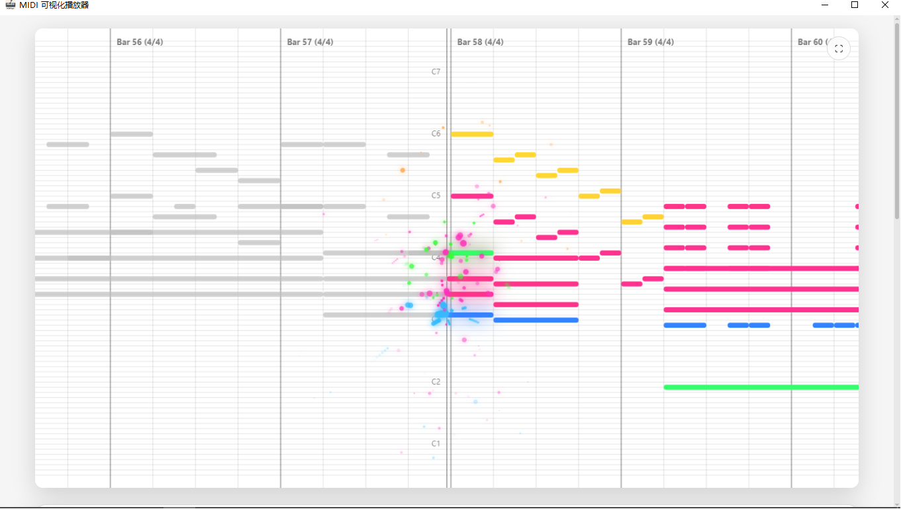
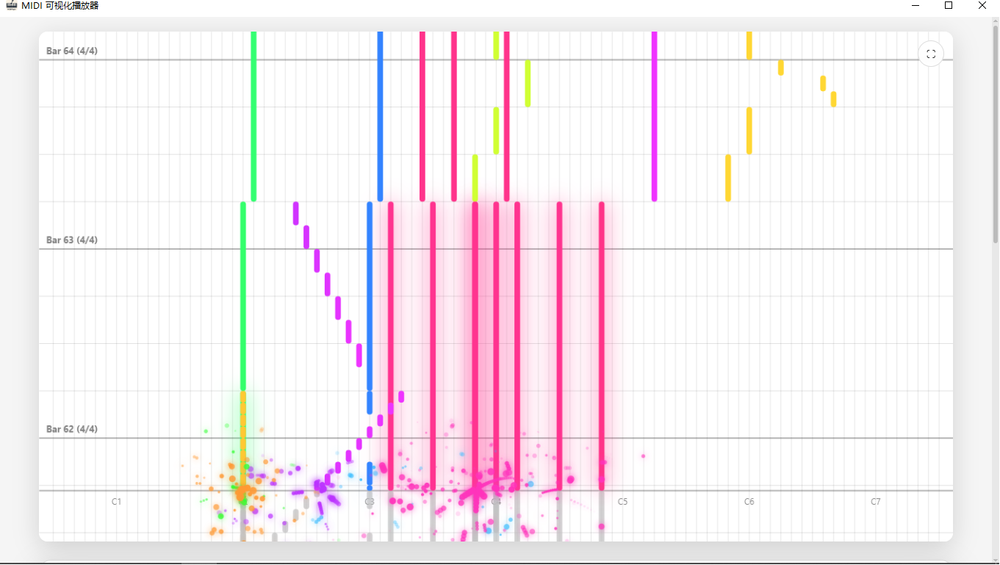

# MIDI 可视化播放器

一个基于 Python + Flask + pywebview 的 MIDI 音频可视化播放器，支持瀑布流动画、粒子特效、多种音色库。

界面使用 WinUIonWeb 项目的真实 WinUI 3 组件实现（Vue 3 + Vite 构建），支持浅色 / 深色 / 跟随系统三态主题。

---

## 预览

| 浅色模式 | 深色模式 |
|:---:|:---:|
|  |  |

| 加载 MIDI 后的音轨面板 |
|:---:|
|  |

| 水平模式 | 垂直模式 |
|:---:|:---:|
|  |  |


## 功能特性

- **MIDI 播放** — 支持 `.mid` / `.midi` 文件
- **瀑布流可视化** — 支持水平/垂直两种方向
- **粒子特效** — 音符碰撞时产生粒子效果
- **音符发光** — 自定义发光效果开关
- **可调速度** — 瀑布流滚动速度实时调整
- **独立音量** — 每个音轨独立控制音量/静音
- **循环播放** — 支持单曲循环
- **深色模式** — 浅色 / 深色 / 跟随系统三态切换，设置自动保存
- **GM 音色库** — 内置 FluidR3_GM 等音色库
- **全屏模式** — 支持原生窗口全屏（隐藏鼠标）
- **拖拽导入** — 拖拽MIDI文件到窗口即可加载


## 使用方法

### 直接运行（Python）
```bash
cd "MIDI Player"
.venv\Scripts\pythonw.exe "MIDI Player.py"
```

前端构建产物已提交到 `assets/`，克隆后即可直接运行；只有修改前端源码时才需要重新构建。

### 构建前端

前端源码在 `frontend/`，使用 Vue 3 + Vite，界面组件直接取自 WinUIonWeb。

```bash
cd frontend
pnpm install
pnpm build          # 产物输出到 ../assets（Flask 静态目录）
```

### 构建单文件 exe（C++ / WebView2 宿主，推荐）

宿主是原生 C++：用 WebView2 承载前端，用它的资源拦截替代 Flask（**不启 HTTP 服务器**），
并把前端产物与音色库以 zip 追加在 exe 尾部、运行时映射进内存按需切片读取（**不产生任何解压**）。
因此**启动约 0.1 秒**、无需 Python 运行时，并且仍然是单文件分发。

依赖（一次性准备）：

- `clang++`（MinGW-w64 目标；本机用的是 Windhawk 自带的 LLVM 20）
- [Microsoft.Web.WebView2](https://www.nuget.org/packages/Microsoft.Web.WebView2) SDK 中的 `WebView2.h` 与 `WebView2Loader.dll`

```bash
# 1) 构建前端产物到 assets/
cd frontend && pnpm build

# 2) 编译宿主 + 嵌入图标 + 追加资源包
pwsh -File host/build.ps1
# 产物：host/build/MIDI Player.exe（约 93 MB，音色内置）

# 3) 校验资源包完整性
"host/build/MIDI Player.exe" --selfcheck
```

> 仓库同时保留了旧的 Python 宿主（`MIDI Player.py` + Flask + pywebview）以便对照，
> 但它在单文件模式下需要先把运行时解压到 `%TEMP%`（即便音色外置也要约 2 秒），
> 所以默认分发 C++ 宿主。

### 已打包版本
前往[Releases](https://github.com/0anmuxi0/MIDI-Player/releases)页面下载构建好的版本

---

## 技术栈

- **后端**: Python, Flask, pywebview
- **前端**: Vue 3, Vite, HTML5 Canvas, Tone.js
- **界面组件**: WinUIonWeb（WinUI 3 设计语言与控件实现，位于 `frontend/src/winui/`）
- **音色库**: FluidR3_GM, FatBoy, Salamander
- **打包**: PyInstaller

## 目录结构

```
MIDI Player.py           Flask 服务 + pywebview 窗口
assets/                  前端构建产物（Tone.js、midi 解析库也在此）
frontend/                前端源码
  src/App.vue            界面（WinUIonWeb 组件组合）
  src/player/player.js   引擎：Tone.js 音频调度 + Canvas 渲染 + MIDI 解析
  src/winui/             从 WinUIonWeb 原样复制的组件与 theme.css
soundfonts/              音色库（开发模式直接读取）
soundfonts.zip           打包用音色归档（由 tools/pack_soundfonts.py 生成，不提交仓库）
tools/pack_soundfonts.py 生成打包用音色归档
```
